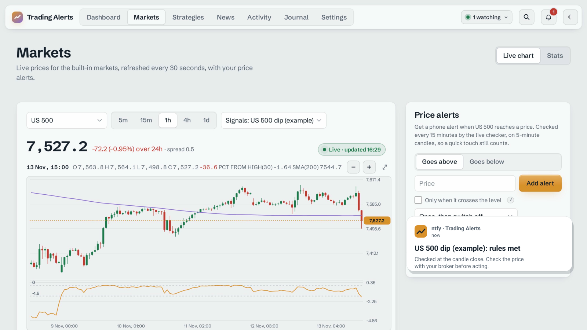

# Trading Alerts

**Backtest, forward-test and get phone alerts for trading rules you write yourself.**
Runs on your own computer or server. Open source under the [GNU AGPL-3.0](LICENSE).
It never places trades, and it doesn't sell signals.



> **Not financial advice.** Trading Alerts follows rules you set. It doesn't recommend trades.
> Backtests are simulations, and leveraged products such as CFDs and spread bets carry a high risk of
> losing money. See [engine/DISCLAIMER.md](engine/DISCLAIMER.md).

## Install (self-hosted, free)

You need **Python 3.10+**.

1. Download the latest [release](../../releases/latest) and unzip it.
2. Run the setup script:
   - **Linux / macOS:** `./setup.sh`
   - **Windows:** right-click `setup.ps1` → *Run with PowerShell*
3. Choose how to run it: in your browser (http://localhost:8321), as a background service,
   as a desktop app, or in Docker (`./setup.sh --docker`).

Everything installs into its own folder, and your data lives in `~/TradingAlerts`.
Full guide: [selfhost/README.md](selfhost/README.md).

**Linux desktop app:** a `.deb` and an `.AppImage` are attached to each [release](../../releases/latest).

## What's in it

| | |
|---|---|
| **Guided Setup** | Five common trading ideas with plain-language settings. No code, no YAML |
| **Visual rule builder** | 20+ indicators, all / any / none groups, crossovers, time windows and weekdays, shown as a plain-English sentence |
| **YAML** | *Advanced: Edit YAML* for power users. Format reference in [engine/README.md](engine/README.md) |
| **Backtester** | Closed-candle signals, next-open fills, stop wins same-bar ties, spread / slippage / funding / commission / borrow costs, lookahead tests |
| **Validation** | Train/test split, Luck Check (Monte Carlo and random price paths), Optimiser with hold-out and anchored walk-forward |
| **Forward tests** | Paper trading on live prices with the same simulator, plus a live-vs-backtest range check |
| **Alerts** | ntfy, Telegram, Discord, Slack, email, webhook. Price alerts, drawdown and data-problem warnings, daily summary |
| **Journal & portfolio** | Log real trades from paper trades, track slippage, export CSV, combine strategies on one balance |
| **Markets** | Indices, gold, silver, oil, EUR/USD, GBP/USD, Bitcoin, US stocks, or your own CSV candles |
| **Data sources** | Yahoo, Dukascopy, OANDA (your own key), CSV upload |

Your data stays on your machine as SQLite and YAML. The browser makes no outside requests.

## Don't want to keep a computer on 24/7?

Forward tests and alerts only run while Trading Alerts is running. The **hosted edition**
runs them on an always-on server, in your browser on Windows, macOS and phones or in the
Linux desktop app. **£9/month, 7-day free trial.**
→ [trading.william-cooper.uk](https://trading.william-cooper.uk/?utm_source=github&utm_medium=readme&utm_campaign=launch)

## Development

```
engine/      the Python package: engine, web interface (plain JS, no framework), tests
selfhost/    setup scripts, Docker files and the desktop app (Tauri)
scripts/     release.py builds the downloadable zip
```

```bash
python -m venv .venv && . .venv/bin/activate
pip install -e "engine[dev,yahoo]"
pytest engine/tests
tradealerts serve        # http://localhost:8321
```

## Licence

Copyright (C) 2026 William Cooper. This program is free software: you can redistribute it
and/or modify it under the terms of the GNU Affero General Public License, version 3. If you
run a modified version as a service other people use over a network, you must offer them
its source code. See [LICENSE](LICENSE).
