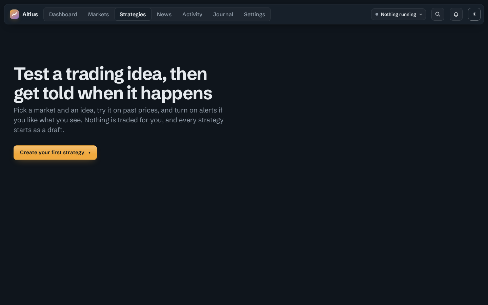
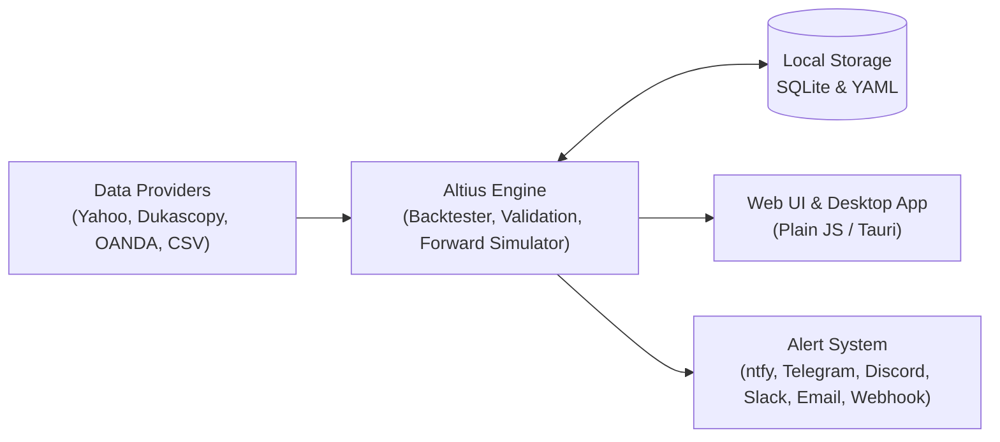

# Altius

**Your trading rules. Your infrastructure. Your alerts.**

Backtest, forward-test, and get phone alerts for trading rules you write yourself.  
Open source under [GNU AGPL-3.0](LICENSE). Runs locally on your own computer or server. It never places trades, and it doesn't sell signals.

[](LICENSE)
[](https://www.python.org/downloads/)

[First 5 Minutes](#your-first-5-minutes-with-altius) · [Features](#key-features) · [Install](#install-self-hosted-free) · [Methodology](#backtesting-methodology--transparency) · [Privacy & Architecture](#privacy--architecture) · [Self-Hosted vs Hosted](#self-hosted-vs-hosted) · [Development](#development)



> [!IMPORTANT]
> **Not financial advice.** Altius follows rules you set—it doesn't recommend trades.
> Backtests are simulations, and leveraged products such as CFDs and spread bets carry a high risk of
> losing money. See [engine/DISCLAIMER.md](engine/DISCLAIMER.md).

## From idea to live monitoring, without the black box

Altius lets you define your own trading rules, test them against historical data, validate whether their performance could be down to luck, and monitor them against live market prices. **The exact same simulation engine powers both backtesting and forward-testing**, helping you compare expected and observed behaviour—without handing over custody of your strategies or automating live orders.

## How it works

1. **Define** – Build rules with Guided Setup, the visual rule builder, or YAML.
2. **Backtest** – Simulate historical trades with realistic fills and transaction costs.
3. **Validate** – Check robustness with train/test splits, Monte Carlo luck checks, and walk-forward optimisation.
4. **Forward-test** – Paper-trade on live prices using the same simulator and a live-vs-backtest range check.
5. **Alert** – Receive notifications on your phone or desktop via ntfy, Telegram, Discord, Slack, email, or webhook.

## Your first 5 minutes with Altius

1. **Install and launch Altius** using `./setup.sh` (Linux/macOS) or `setup.ps1` (Windows), then open `http://localhost:8321`.
2. **Select a market**, such as `EUR/USD`, gold, or a US stock.
3. **Choose a predefined strategy** from **Guided Setup** (or build your own in the visual rule builder).
4. **Run your first backtest** on historical data.
5. **Inspect the performance metrics**, equity curve, drawdown, and Luck Check results.
6. **Set up an alert** (e.g. Telegram or ntfy) to get notified when your rule triggers on live prices.

## Key features

### Strategy building
- **Guided Setup:** Five common trading ideas with plain-language settings. No code, no YAML.
- **Visual rule builder:** 20+ indicators, `all` / `any` / `none` groups, crossovers, time windows, and weekdays, shown as a plain-English sentence.
- **YAML:** *Advanced: Edit YAML* for power users. Format reference in [engine/README.md](engine/README.md).

### Backtesting & validation
- **Backtester:** Closed-candle signals, next-open fills, stop wins same-bar ties, spread / slippage / funding / commission / borrow costs, and lookahead tests.
- **Validation:** Train/test split, Luck Check (Monte Carlo and random price paths), and Optimiser with hold-out and anchored walk-forward.

### Live monitoring & alerts
- **Forward tests:** Paper trading on live prices with the same simulator, plus a live-vs-backtest range check.
- **Alerts:** ntfy, Telegram, Discord, Slack, email, and webhook. Price alerts, drawdown and data-problem warnings, and daily summaries.

### Journal & data
- **Journal & portfolio:** Log real trades from paper trades, track slippage, export CSV, and combine strategies on one balance.
- **Markets & data sources:** Indices, gold, silver, oil, EUR/USD, GBP/USD, Bitcoin, US stocks, or your own CSV candles via Yahoo Finance, Dukascopy, OANDA (your own key), or CSV upload.

## Install (self-hosted, free)

**Prerequisites:** **Python 3.11+** on Linux, macOS, or Windows (no administrator privileges required for standard user install).

1. Download and unzip the latest [release](../../releases/latest).
2. Run the setup script for your platform:
   - **Linux / macOS:**
     ```bash
     ./setup.sh
     ```
   - **Windows:** right-click `setup.ps1` → *Run with PowerShell*
3. Choose how to run it:
   - **Browser:** `http://localhost:8321`
   - **Background service**
   - **Desktop app** (Linux `.deb` and `.AppImage` are also attached to each [release](../../releases/latest))
   - **Docker:** `./setup.sh --docker`

Everything installs into its own folder, and your data lives in `~/TradingAlerts` (back up or restore by copying this directory; uninstall by removing the install folder).  
For upgrades, troubleshooting, and full details, see [selfhost/README.md](selfhost/README.md).

## Backtesting methodology & transparency

Trust is critical in trading software. Altius is explicit about how simulations are run:

- **Signal & fill timing:** Signals are evaluated on **closed candles** only, with fills executed at the **next-bar open**. Same-bar stop/target ties resolve conservatively in favor of the stop. Automated lookahead tests verify rules cannot peek at future bars.
- **Transaction costs & friction:** Models spread, slippage, funding, commission, and borrow costs.
- **Statistical validation:** Includes train/test splits, **Luck Check** (Monte Carlo and random price paths), and an Optimiser with hold-out and anchored walk-forward testing.
- **Paper trading & data limitations:** Forward tests run on live prices using the same simulator, paired with a live-vs-backtest range check. Historical and live data accuracy depends on your chosen provider (Yahoo Finance, Dukascopy, OANDA, or your own CSVs).

## Privacy & architecture



- **Local storage & zero telemetry:** Your strategies, backtests, journal entries, and API credentials (such as OANDA tokens) are stored locally in `~/TradingAlerts` as SQLite and YAML. Altius sends **no telemetry**.
- **Browser isolation:** The web interface only talks to your local Altius server and makes no outside requests.
- **External connections (backend only):** Your local Altius backend only contacts the market-data provider you choose (Yahoo, Dukascopy, OANDA) and the notification services you configure (ntfy, Telegram, Discord, Slack, email, webhook).
- **Hosted edition:** If you use the managed cloud edition, your strategies and data are stored on the hosted server instead of your local machine.

## Self-hosted vs hosted

| | Self-hosted | Hosted |
|---|---|---|
| **Price** | **Free** (AGPL-3.0) | **£9/month** (7-day free trial) |
| **Infrastructure** | Your own computer or server | Managed, always-on server |
| **Uptime** | Runs while your machine is on | 24/7 monitoring and alerts |
| **Access** | Local browser or Linux desktop app | Browser (Windows, macOS, mobile) or Linux desktop app |
| **Setup** | `./setup.sh` / `setup.ps1` / Docker | Ready to use — [Try Altius free](https://trading.william-cooper.uk/?utm_source=github&utm_medium=readme&utm_campaign=launch) |

## Capabilities & design choices

| Capability | Why it matters |
|---|---|
| **Self-hosted** | Full control over your infrastructure and strategy data |
| **Visual strategy builder** | Accessible to independent traders without writing code |
| **YAML strategies** | Version-controllable, reproducible rules for technical users |
| **Walk-forward testing** | Out-of-sample validation to reduce overfitting |
| **Monte Carlo validation** | Robustness testing against random chance |
| **Live forward-testing** | Real-world comparison using the same simulator |
| **Transaction cost modelling** | More realistic simulations (spread, slippage, funding, commission) |
| **No automated execution** | Clear operational boundaries—alerts only, never places trades |

## Development

```text
engine/      Python package: engine, web interface (plain JS, no framework), tests
selfhost/    Setup scripts, Docker files, and the desktop app (Tauri)
scripts/     release.py builds the downloadable zip
```

```bash
python -m venv .venv && . .venv/bin/activate
pip install -e "engine[dev,yahoo]"
pytest engine/tests
tradealerts serve        # http://localhost:8321
```

## Licence

Copyright (C) 2026 William Cooper. This program is free software: you can redistribute it
and/or modify it under the terms of the GNU Affero General Public License, version 3. If you
run a modified version as a service other people use over a network, you must offer them
its source code. See [LICENSE](LICENSE).
