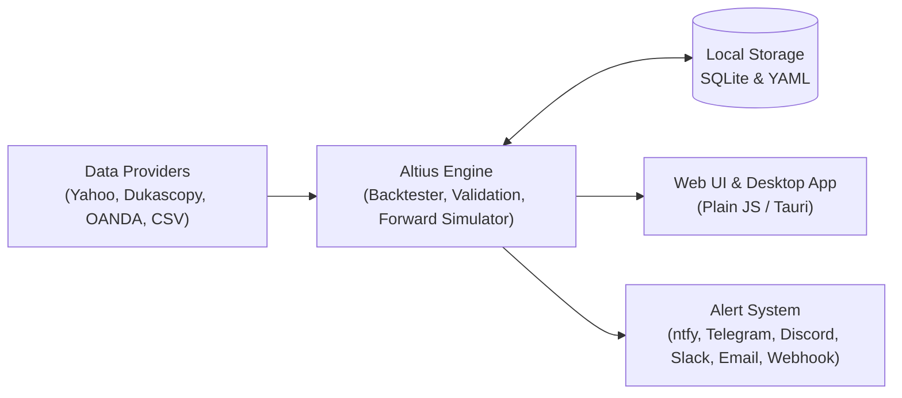

# Altius

**Your trading rules. Your infrastructure. Your alerts.**

Backtest, forward-test, and get phone alerts for trading rules you write yourself.  
Open source under [GNU AGPL-3.0](LICENSE). Runs locally on your own computer or server. It never places trades, and it doesn't sell signals.

[](LICENSE)
[](https://www.python.org/downloads/)

[Install](#install-self-hosted-free) · [Architecture](#architecture) · [Methodology & Trust](#backtesting-methodology--transparency) · [Comparison](#how-altius-compares) · [Hosted Edition](#dont-want-to-keep-a-computer-on-247) · [Development](#development)


> [!IMPORTANT]
> **Not financial advice.** Altius follows rules you set—it doesn't recommend trades.
> Backtests are simulations, and leveraged products such as CFDs and spread bets carry a high risk of
> losing money. See [engine/DISCLAIMER.md](engine/DISCLAIMER.md).

## Why Altius

- **Open source & self-hosted:** Your data stays on your machine as SQLite and YAML. The browser makes no outside requests.
- **User-defined strategies:** Build rules with Guided Setup, the visual rule builder, or YAML—no black-box signals.
- **Backtesting & forward testing:** Test on historical data, validate against luck, and paper-trade on live prices using the exact same simulator.
- **Phone notifications:** Get alerted via ntfy, Telegram, Discord, Slack, email, or webhooks.
- **Optional hosted experience:** Run it free on your own hardware, or use the always-on hosted edition.

## How it works

1. **Define your rules** using the Guided Setup, the visual rule builder, or YAML.
2. **Backtest & validate** with realistic fills, transaction costs, train/test splits, and Monte Carlo luck checks.
3. **Forward-test & get alerted** on live prices via your preferred notification channel.

## Architecture



## Backtesting Methodology & Transparency

Trust is critical in trading software. Altius is explicit about how simulations are run:

- **Signal & fill timing:** Signals are evaluated on **closed candles** only, with fills executed at the **next-bar open**. Same-bar stop/target ties resolve conservatively in favor of the stop. Automated lookahead tests verify rules cannot peek at future bars.
- **Transaction costs & friction:** Models spread, slippage, funding, commission, and borrow costs.
- **Statistical validation:** Includes train/test splits, **Luck Check** (Monte Carlo and random price paths), and an Optimiser with hold-out and anchored walk-forward testing.
- **Paper trading & data limitations:** Forward tests run on live prices using the same simulator, paired with a live-vs-backtest range check. Historical and live data accuracy depends on your chosen provider (Yahoo Finance, Dukascopy, OANDA, or your own CSVs).

## Install (self-hosted, free)

**Prerequisite:** **Python 3.11+**

1. Download and unzip the latest [release](../../releases/latest).
2. Run the setup script for your platform:
   - **Linux / macOS:**
     ```bash
     ./setup.sh
     ```
   - **Windows:** right-click `setup.ps1` → *Run with PowerShell*
3. Choose how to run it:
   - **Browser:** `http://localhost:8321`
   - **Background service**
   - **Desktop app** (Linux `.deb` and `.AppImage` are also attached to each [release](../../releases/latest))
   - **Docker:** `./setup.sh --docker`

Everything installs into its own folder, and your data lives in `~/TradingAlerts`.  
For full details, see [selfhost/README.md](selfhost/README.md).

## What's in it

| Feature | Details |
|---|---|
| **Guided Setup** | Five common trading ideas with plain-language settings. No code, no YAML. |
| **Visual rule builder** | 20+ indicators, `all` / `any` / `none` groups, crossovers, time windows, and weekdays, shown as a plain-English sentence. |
| **YAML** | *Advanced: Edit YAML* for power users. Format reference in [engine/README.md](engine/README.md). |
| **Backtester** | Closed-candle signals, next-open fills, stop wins same-bar ties, spread / slippage / funding / commission / borrow costs, and lookahead tests. |
| **Validation** | Train/test split, Luck Check (Monte Carlo and random price paths), and Optimiser with hold-out and anchored walk-forward. |
| **Forward tests** | Paper trading on live prices with the same simulator, plus a live-vs-backtest range check. |
| **Alerts** | ntfy, Telegram, Discord, Slack, email, and webhook. Price alerts, drawdown and data-problem warnings, and daily summaries. |
| **Journal & portfolio** | Log real trades from paper trades, track slippage, export CSV, and combine strategies on one balance. |
| **Markets** | Indices, gold, silver, oil, EUR/USD, GBP/USD, Bitcoin, US stocks, or your own CSV candles. |
| **Data sources** | Yahoo Finance, Dukascopy, OANDA (your own key), and CSV upload. |

## How Altius compares

| | Altius | Cloud Charting Platforms | Code-Only Backtesters |
|---|---|---|---|
| **Self-hosted & local data** | Yes (SQLite + YAML) | No | Yes |
| **No-code visual builder** | Yes | Partial (scripts needed) | No |
| **Built-in phone alerts** | Yes (ntfy, Telegram, etc.) | Paid tiers | DIY |
| **Live forward-testing** | Yes (same simulator) | Limited | DIY |
| **Open source** | Yes (AGPL-3.0) | No | Yes |

## Don't want to keep a computer on 24/7?

Forward tests and alerts only run while Altius is running. The **hosted edition** runs them on an always-on server—accessible in your browser on Windows, macOS, and phones, or in the Linux desktop app.

- **£9/month** with a **7-day free trial** → [trading.william-cooper.uk](https://trading.william-cooper.uk/?utm_source=github&utm_medium=readme&utm_campaign=launch)

## Development

```text
engine/      Python package: engine, web interface (plain JS, no framework), tests
selfhost/    Setup scripts, Docker files, and the desktop app (Tauri)
scripts/     release.py builds the downloadable zip
```

```bash
python -m venv .venv && . .venv/bin/activate
pip install -e "engine[dev,yahoo]"
pytest engine/tests
tradealerts serve        # http://localhost:8321
```

## Licence

Copyright (C) 2026 William Cooper. This program is free software: you can redistribute it
and/or modify it under the terms of the GNU Affero General Public License, version 3. If you
run a modified version as a service other people use over a network, you must offer them
its source code. See [LICENSE](LICENSE).
